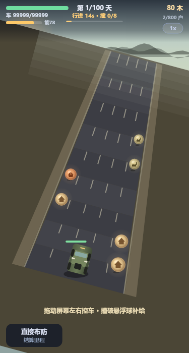
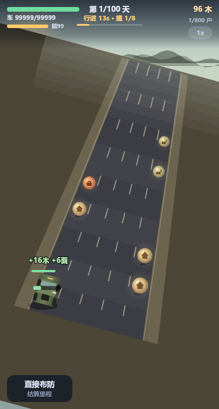
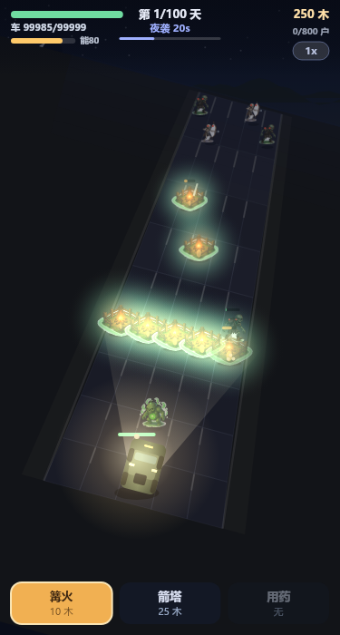

# 永夜微光 · Nightfall Glow

末世公路生存主题的**微信小游戏**。开着越野车一路向前：白天在废墟公路上搜刮补给，黄昏布防，夜晚守车。**坚守 100 天** 或 **开过 800 户抵达救援中心**，任一条达成即胜利。

<p>
  
  
  
</p>

> 这是**微信小游戏**工程（Canvas 渲染，`game.js` 入口），不是小程序，没有 WXML 页面。

## 快速试玩

- **浏览器直接玩**：打开 [`demo/preview.html`](demo/preview.html)（2.3MB 单文件，图片已内联，双击即跑，无需服务器）
- **微信开发者工具**：导入 `minigame/` 目录，`compileType: game`，AppID 可用测试号

## 目录

```
.
├── demo/preview.html          单文件可玩预览（由 tools/build_preview.py 生成）
├── docs/                      各版本游戏设计方案
├── minigame/                  微信小游戏工程（源码 + 素材）
├── tools/                     无头测试 / 平衡模拟 / 离屏渲染 / 预览构建
│   └── assets-preprocess/     一次性素材预处理脚本（留档）
└── screenshots/               场景截图与美术风格基准
```

工程内部结构与完整数值表见 [`minigame/README.md`](minigame/README.md)，工具用法见 [`tools/README.md`](tools/README.md)。

## 一天 60 秒

| 阶段 | 时长 | 你在做什么 |
|---|---|---|
| ① 行进 | 15s | 车自动前进，**拖屏幕左右控车**，撞破外道悬浮球补给。能量每跨 1 户 −1 |
| ② 黄昏布防 | 15s | 建造 **0 耗时**，纯思考。可暂停 1 次 10s，可「直接布防」换时间 |
| ③ 夜晚防守 | 30s | 建/修各 1s（加速药 0.5s），篝火烧怪、箭塔输出、怪拆你建筑 |

行进用不完的时间会**并入黄昏**，所以升级车速 = 换布防时间。夜晚结束后回到第 1 阶段，循环至胜负。

## 白天：碰碰车

车宽 1 条车道，只控左右、自动前进。每天 8 个悬浮球挂在最外侧两条车道，按「左左右右」成对分布——一次横穿能连吃两个。撞上即搜刮 1.4s，**期间车停住但 15 秒倒计时照走**；开过去就永久错过。

这条规则把白天从「静态计算」变成「要不要为了这个球绕一趟」的取舍。完全不碰屏 = 中路直冲到底，一条真实存在但没资源的路。

**硬门槛**：搜刮 8 个 = 11.2s，15s 只剩 3.8s 行驶 → Lv1/Lv2 每天只能推 7 户，**车速升到 Lv3 才推满 8 户**。800 ÷ 100 = 每天 8 户，所以不升级就拿不到「抵达救援中心」这条胜利线。

## 战场

竖版 5 车道 × 9 行纵深格，整体顺时针旋转 **15°**，公路斜着向上。相机跟车：车固定画在屏幕纵深 `v=0.30`，其余物体按相对纵深叠加；远端路宽收敛到近端 46%。世界坐标 ↔ 屏幕坐标走 `w2s()` / `s2w()`，点击经反旋转 + 反透视落到格子。

## 设计文档

| 文件 | 内容 | 状态 |
|---|---|---|
| [`docs/游戏设计方案_MVP.html`](docs/游戏设计方案_MVP.html) | 最初竖版 5 路俯视玩法 | 历史 |
| [`docs/游戏设计方案_v2_公路探索.html`](docs/游戏设计方案_v2_公路探索.html) | 公路 + 房子 + 越野车的方向确立 | 历史 |
| [`docs/游戏设计方案_v3_公路探索.html`](docs/游戏设计方案_v3_公路探索.html) | 两阶段白天、篝火路障、15° 斜投影 | 历史 |
| [`docs/游戏设计方案_v1.0_定稿.html`](docs/游戏设计方案_v1.0_定稿.html) | 数值冻结，与 `core.js` 常量一一对应 | 已被 v1.1 取代 |
| [`docs/游戏设计方案_v1.1_碰碰车.html`](docs/游戏设计方案_v1.1_碰碰车.html) | 白天改为拖车碰悬浮球，含新时间账推导 | **现行** |

> 版本号有个历史曲折：草案阶段按 v2 / v3 递增，冻结交付时重编为 v1.0，之后是 v1.1。上表按时间顺序排列。

## 开发工具

```bash
# 78 项无头回归（几何 / 驾驶 / 碰撞 / 建造 / 昼夜流转 / 胜负）
node tools/test_core.js

# 平衡探针：自动玩家跑满 100 天，输出每日存活与里程
node tools/balance_probe.js 0 0

# 离屏截图：travel / swing / search / dusk / night / pick / over
node tools/render_shot.js 375 700 night

# 重建 assets.js + 单文件浏览器预览
python tools/build_preview.py
```

离屏渲染依赖 `@napi-rs/canvas`，运行时需设 `NODE_PATH` 指向其安装位置。

## 当前状态

- 核心循环、双胜利条件、怪物 AI、建造与修补、图纸三选一均已跑通
- 78 项回归断言全通过；自动玩家（非最优操作）5 次采样存活 34~53 天、里程 269~421 户
- **待办**：微信开发者工具真机验收（重点验证触摸坐标换算与拖拽是否带动页面滚动）；难度是否下调待定；悬浮球 / 路面 / 越野车 / 救援中心目前为 Canvas 矢量绘制，贴图接口已按 `images["orb/<type>"]`、`images["car/jeep"]` 预留

## 许可

个人项目，暂未指定开源许可。
